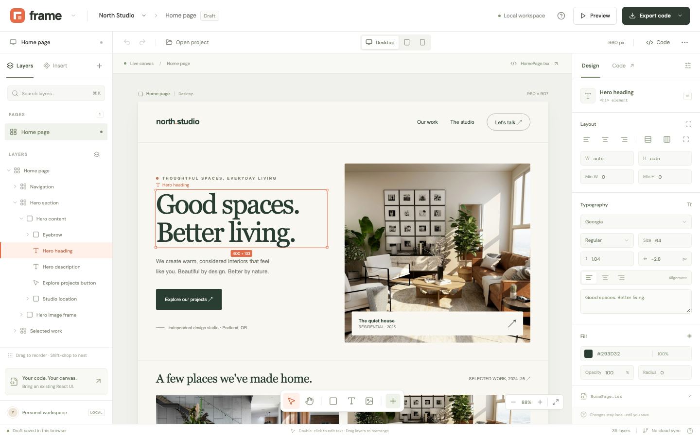

<div align="center">



# Frame

**Edit a React component on a canvas, then save the change back to its .tsx file.**

[](LICENSE)
[](https://nodejs.org)
[](#privacy)

</div>

Frame opens a `.jsx` or `.tsx` component in the browser and renders its JSX as a page you can click on. Select an element, change its text, size, typography, color, or spacing, drag layers into a new order, and save. Frame rewrites only the JSX it shows you. Imports, hooks, handlers, and the rest of the file stay byte-for-byte the same.

The editor opens on North Studio, a demo page that loads through the same import code as your own files.

## Quick start

You need Node.js 22.12 or newer.

```sh
git clone https://github.com/SedWilliams/drag_and_drop_UI.git
cd drag_and_drop_UI
npm install
npm run dev
```

The editor opens at <http://127.0.0.1:5173>.

Use Chrome or Edge to connect a folder and save straight to files. Other browsers can open a single file or pasted JSX and export it as a download. File access only works on localhost or HTTPS.

## Edit a component from your app

1. Start your app's dev server as usual.
2. In Frame, click **Open project**. Connect your project folder and pick a component, open a single file, or paste JSX.
3. Select an element on the canvas or in Layers, and change it in the Design panel.
4. Click **Save to file** or press Cmd/Ctrl+S. Your dev server picks up the saved file.
5. If you uploaded or pasted the source, click **Export code** instead and put the downloaded file in your project.

Before every save, Frame checks that the file still holds the text it last read or wrote. If another editor changed it, Frame refuses to overwrite it and shows an error. Download your edits and merge them, or reopen the file.

Drafts autosave to browser storage and survive a reload. File connections don't, so reopen the file after a reload to save to it again. A draft lives only in this browser, so save or export anything you want to keep.

## Use

| Action | How |
| --- | --- |
| Select | Click an element on the canvas or a row in Layers |
| Edit text | Double-click text on the canvas, or use the text box in Design |
| Reorder | Drag a layer onto another. Hold Shift while dropping to nest it inside |
| Insert | Click an entry in the Insert tab, or drag it onto a container on the canvas |
| Resize | Drag the selection's bottom-right handle |
| Lock or hide | Use the icons at the end of a layer row. Hidden elements export as `display: none` |
| Change width | Switch between the Desktop 960px, Tablet 768px, and Mobile 390px viewports |
| Pan and zoom | Use the hand tool and the zoom controls at the bottom right |
| See the code | Click **Code** to view, copy, or download the generated source |

| Key | Action |
| --- | --- |
| Cmd/Ctrl+Z | Undo, up to 60 steps |
| Cmd/Ctrl+Shift+Z or Cmd/Ctrl+Y | Redo |
| Cmd/Ctrl+D | Duplicate the selected layer |
| Delete or Backspace | Delete the selected layer |
| Cmd/Ctrl+K | Search layers |
| Cmd/Ctrl+S | Save to file, or export |
| Esc | Leave preview or close a dialog |
| ? | Show shortcuts |

## How it works

Frame parses the component with Babel and finds its JSX root, preferring the default export. It builds an editable tree from that root. HTML elements and literal text become layers. Custom components and `{expressions}` become placeholders that export unchanged.

On save, Frame parses the original source again and rebuilds the root from the tree. It starts from a copy of each original JSX node, changes only what you edited, and splices the result back into the source text. A style edit replaces the matching key in the inline `style` object. Spreads and variables in that object stay, and your value goes after them so it takes effect.

## Limits

Frame edits static JSX. It doesn't run your app.

- It edits one JSX root in one component at a time. Split components with several conditional returns or nested render functions before editing them.
- Hooks, event handlers, and other app logic don't run in the preview. Custom components and dynamic expressions show as placeholders.
- The preview doesn't load external CSS, CSS modules, Tailwind, imported fonts, or your build config. Class names survive export, but the preview won't match an app that depends on them. Inline styles beat most class rules, though `!important` rules and JSX prop spreads can still override them at runtime.
- Frame doesn't copy or rewrite image paths. Relative paths resolve against Frame in the preview and against your app after export. Copy `public/images` if you export the demo into another app.
- Switching viewports changes the preview width. It doesn't write media queries.
- Layout editing uses normal CSS flow and flexbox. There's no free positioning, multi-selection, vector drawing, component variants, multiplayer editing, or Git integration.
- Below 760px wide the Design panel is hidden. The canvas, layers, and export still work.

## Privacy

Frame runs in your browser and never uploads your source. It makes two kinds of network request: the editor's Google Fonts, and any image URLs in the component you open.

## Development

```sh
npm test                          # Vitest unit tests
npx playwright install chromium   # once, for the e2e tests
npm run test:e2e                  # Playwright end-to-end tests
npm run build                     # type check, then production build
npm run format                    # Prettier
```

The unit tests cover JSX round trips, style variables, tree operations, and the file conflict check. The Playwright tests drive the demo through editing, undo, persistence, drag and drop, resizing, viewports, export, locking, and saving through a fake file handle. Native permission prompts still need a manual check.

See [CONTRIBUTING.md](CONTRIBUTING.md) before you open a pull request.

## Code map

- `src/model.ts` defines the page tree and the immutable edits on it.
- `src/source.ts` turns JSX into that tree and writes the tree back into the source.
- `src/useEditor.ts` holds the open project, undo history, selection, and draft autosave.
- `src/files.ts` scans folders, saves with the conflict check, and downloads.
- `src/App.tsx` lays out the shell and owns dialogs, preview, shortcuts, and saving.
- `src/components/` has the canvas, layer tree, Design panel, dialogs, and shared controls.
- `src/demo.ts` holds the North Studio demo source.

Demo photos are from Unsplash: [living room](https://images.unsplash.com/photo-1600210492486-724fe5c67fb0) and [kitchen](https://images.unsplash.com/photo-1600607687920-4e2a09cf159d).

## License

[MIT](LICENSE)
